<div align="center">
  <picture>
    <source media="(prefers-color-scheme: dark)" srcset="./banner_dark.svg">
    <source media="(prefers-color-scheme: light)" srcset="./banner_light.svg">
    
  </picture>
</div>

<div align="center">
  
</div>

<br/>

<div align="center">
  <a href="https://www.linkedin.com/in/rajibul-hasan/">
    
  </a>
  <a href="mailto:engrajibulhasan@gmail.com">
    
  </a>
  <a href="https://medium.com/@engrajibulhasan">
    
  </a>
  <a href="tel:+8801727843493">
    
  </a>
  <a href="https://drive.google.com/file/d/1oWlhX5tnPdnc7ubi_cvPQHWRZrZJWbvl/view?usp=sharing">
    
  </a>
</div>

<div align="center">
  
  
  
</div>

<br/>

---

## 👋 About Me


I'm a **Senior Software Engineer** from Dhaka, Bangladesh 🇧🇩, full-stack by trade. For the last **10+ years** I've been turning ideas into **scalable, fast, real-world applications**.

```yaml
Name:        MD. Rajibul Hasan
Role:        Senior Software Engineer
Location:    Dhaka, Bangladesh 🇧🇩  (UTC+6)
Experience:  10+ years full stack · 5+ years React & Next.js
Specialty:   Motivated self-learner · Performance optimisation
Currently:   Building enterprise solutions for global clients
Team:        Cross-border · Agile · Fully remote
Ask Me About: TypeScript · Next.js · Express.js · MongoDB · MySQL
Languages:   Bengali (Native) · English (Fluent)
Open To:     Remote & Onsite Senior Software Engineer roles 🌍
```

<br clear="right"/>

---

## 🎯 What I Bring

<div align="center">

| | |
|---|---|
| ⚡ **Performance** | Query optimisation and render profiling — cut data-visualisation time by **60%+** by removing nested iteration and tuning GoJS. |
| 🌍 **Cross-Border Delivery** | Agile delivery with a distributed US team: standups across time zones, short sprints, incremental releases. |
| 🔐 **Enterprise Auth** | **Keycloak** SSO, role-based access control (RBAC) and multi-factor authentication (MFA) across Next.js app and middleware layers. |
| 📊 **Data at Scale** | **AG Grid Enterprise** grids with custom export pipelines and permission-gated views; live charts over **WebSockets**. |
| 👥 **Team Leadership** | Led and mentored engineers across microservices projects, partnering with UX, Backend and DevOps. |
| 🤖 **AI-Assisted Dev** | Integrated **Claude Code** into day-to-day refactoring without compromising code quality. |

</div>

---

## 🛠️ Tech Stack

<div align="center">


</div>

---

## 🚀 Featured Projects

> 🚧 **Coming soon.** Placeholder content below — real repos and live previews replace it as each project ships.

<div align="center">

| Project | Description | Tech Stack |
|---|---|---|
| 🧩 **Lorem Ipsum Dolor** | Sit amet, consectetur adipiscing elit, sed do eiusmod tempor incididunt. | `Next.js` `TypeScript` |
| 🔮 **Consectetur Adipiscing** | Ut enim ad minim veniam, quis nostrud exercitation ullamco laboris. | `React` `Express.js` |
| ⚙️ **Tempor Incididunt** | Duis aute irure dolor in reprehenderit in voluptate velit esse. | `Node.js` `MongoDB` |

<br/>


</div>

---

## 💼 Experience Snapshot

<div align="center">

| Role | Company | Period | Focus |
|---|---|---|---|
| **Senior Frontend Engineer** | Penta Global Limited | `Nov 2021 – Present` | AngularJS → Next.js migration, Keycloak SSO, AG Grid, team leadership · Remote (US team) |
| **Frontend Developer** | Ehsan Software | `Jun 2021 – Oct 2021` | Django → React migration, Next.js + Socket.IO chat platform, Figma UI/UX |
| **Freelance Frontend Developer** | Self-Employed | `Jul 2019 – Jun 2021` | End-to-end e-commerce frontend, Stripe checkout, React & Next.js · Remote |
| **Full Stack Developer** | Apps Maker BD | `Dec 2015 – Jul 2019` | Led full-stack team, POS system, microcredit management application |

</div>

---

## 📌 Current Focus

- 🚀 **SaaS product development** — building multi-tenant products end to end
- 🏗️ **System design** — scalability, data modelling and clear service boundaries
- 🧠 **AI engineering** — LLMs, RAG and agentic systems, backed by vector search

<div align="center">

<br/>

**🤖 AI ENGINEERING** · *going deep on these right now*


</div>

---

## 📊 GitHub Stats

<div align="center">
  
  &nbsp;
  
</div>

<br/>

<div align="center">
  
</div>

<br/>

<div align="center">
  
</div>

---

## 📈 Contribution Graph

<div align="center">
  
</div>

---

##  Writing

I write on Medium.

<div align="center">
  <a href="https://medium.com/@engrajibulhasan">
    
  </a>
</div>

---

## Let's Connect

<div align="center">
<a href="mailto:engrajibulhasan@gmail.com">
  
</a>
<a href="https://www.linkedin.com/in/rajibul-hasan/">
  
</a>
<a href="https://drive.google.com/file/d/1oWlhX5tnPdnc7ubi_cvPQHWRZrZJWbvl/view?usp=sharing">
  
</a>

</div>

---

<div align="center">
  <sub>
    <b>Senior Software Engineer</b> · Senior Frontend Engineer · React Developer · Next.js Developer · TypeScript Engineer ·
    Redux Toolkit · RTK Query · Tailwind CSS · Keycloak SSO · RBAC · MFA · AG Grid Enterprise ·
    AngularJS to Next.js Migration · Node.js · Express.js · PHP · MongoDB · MySQL · PostgreSQL · Docker ·
    SaaS Product Development · System Design · AI Engineering · LLM · RAG · LangChain · Vector Database ·
    Remote Software Engineer · Full Stack Developer · Dhaka, Bangladesh 🇧🇩
  </sub>
</div>

<div align="center">
  <sub>⚡ Built by <b>MD. Rajibul Hasan</b> · Open to Remote Opportunities 🌍</sub>
</div>
